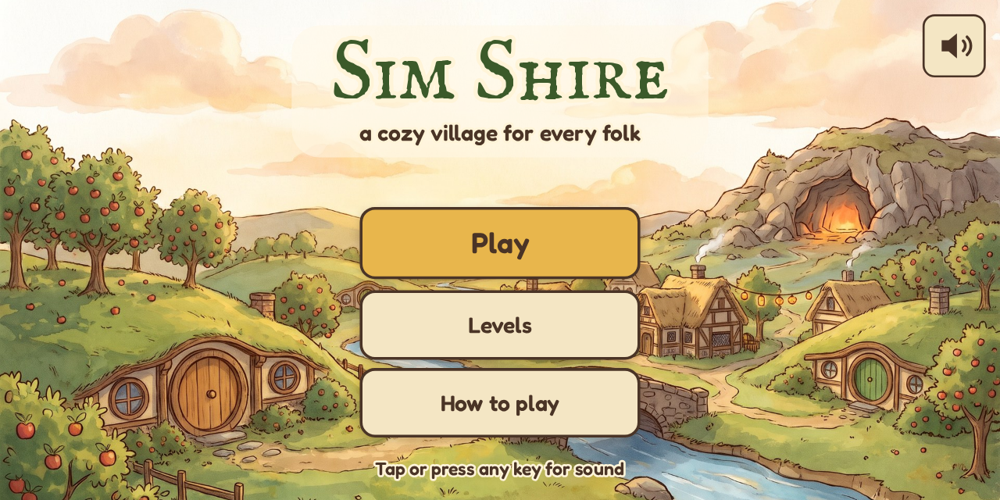
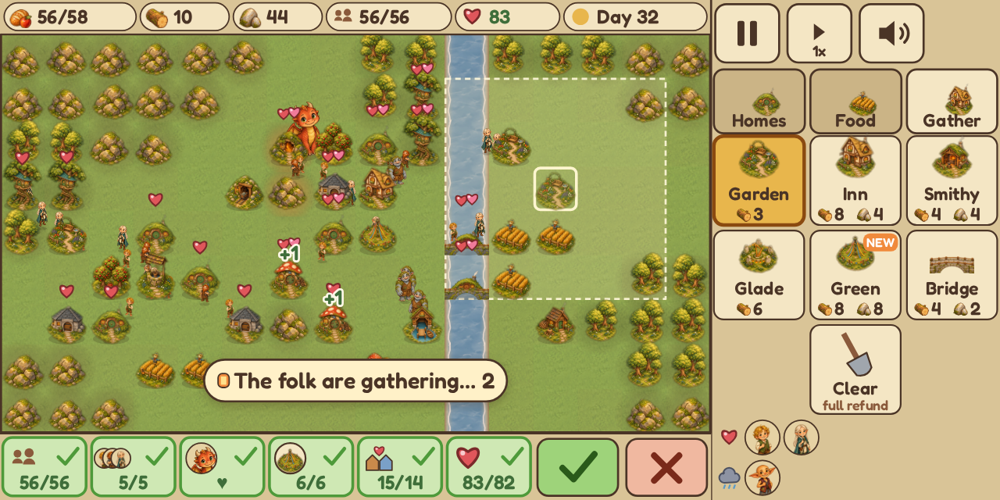
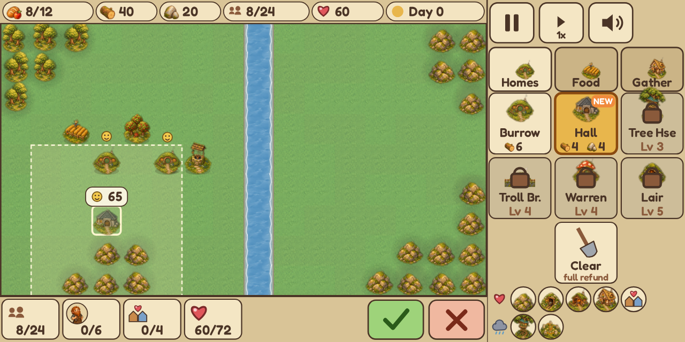
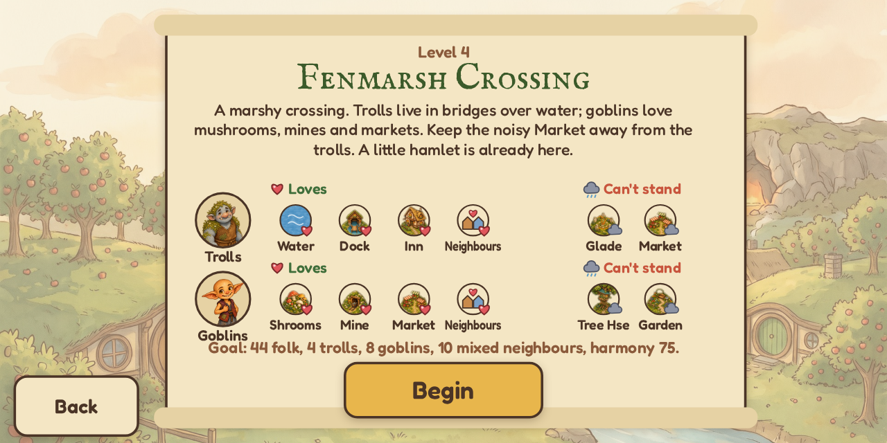
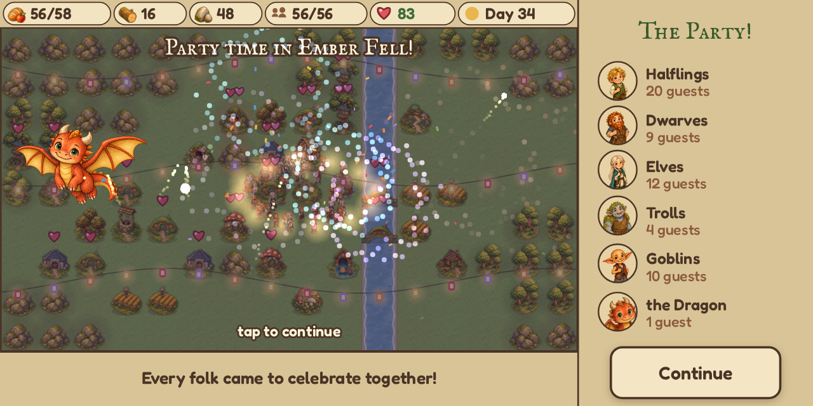
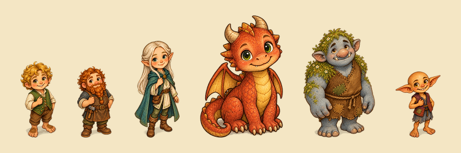
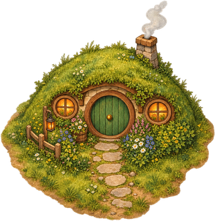
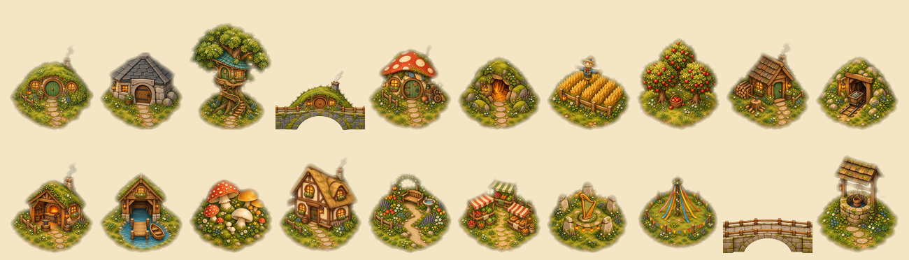
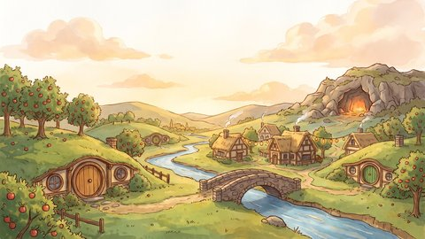
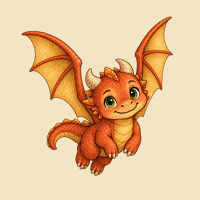

# Sim Shire

*Build a cozy shire where every kind of folk, even a dragon, can live in peace.*

You're the friendly steward of a little valley. Lay out round-doored burrows,
stone halls, tree houses, farms, orchards, bridges and inns, and folk move in.
Every folk has things it loves and things it can't stand, so the fun is in the
arranging: the dwarves want their ringing smithy, the halflings want peace and
quiet and an orchard down the lane, and the elves would really rather not live
next to the goblins. Get it just right and halflings, dwarves, elves, trolls,
goblins and finally a dragon all settle down together, then gather on the
Festival Green for a lantern-lit party with fireworks.

**[▶ Play Sim Shire](https://simshire.synapticnoise.com)** in your browser. No
install, works on desktop and on phones (held sideways).



## The valleys

| | |
|---|---|
|  **A village for everyone.** Five hand-made valleys: Green Hollow, Stonebrook, Elderwood, Fenmarsh Crossing and Ember Fell, each welcoming new folk. |  **See before you build.** Pick a spot and the game shows exactly how much happier, or grumpier, every nearby home would be. |
|  **Meet the folk.** Each valley opens with a scroll of who's arriving and what they love and can't stand. |  **The party.** Gather every folk around a Festival Green and the dragon lights up the sky. |

Each valley adds new folk and new tensions. The halflings come first, then
dwarves who love the clatter of a smithy that halflings can't bear, then elves
who hate woodcutters, then trolls who live *in* bridges and goblins who
adore a noisy market. Last comes a dragon who'd love a warm rock shelf, a mine
full of shiny things, and everyone else to stop being so nervous. Later
valleys start with a little hamlet already settled, and their goals ask the
folk to live as real neighbours, not in separate corners.

## The folk



- **Halflings** live in burrows and love orchards, gardens and a good inn.
  Smithies, woodcutters and dragons make them nervous.
- **Dwarves** build stone halls by the rocks and love mines and smithies. They
  find tree houses and music glades a bit much.
- **Elves** live up in tree houses and love forests, water, gardens and music,
  but not woodcutters, smithies or goblin warrens.
- **Trolls** make their homes inside bridges, love water, fishing docks and
  inns, and grumble about markets and music.
- **Goblins** live in mushroom-capped warrens and love mushrooms, mines and
  markets. Tree houses and tidy gardens? No thank you.
- **The dragon** needs one warm rock shelf, a mine and a smithy nearby, and
  plenty of room. Keep it cheerful and its warmth makes the whole valley a
  little happier.

Everyone also likes having **neighbours of a different folk** nearby. An
**Inn** halves every grudge around it, and a **Festival Green** cheers up
everyone near it and calms their fear of the dragon.

## How to play

- **Build:** pick a building from the column on the right (Homes, Food,
  Gathering) and click a tile. On a phone, tap a tile to preview it, then tap
  it again (or ✓) to build.
- **Ask a home how it feels:** with no building selected, tap a home to see
  every reason it's happy or grumpy. Tap a goal at the bottom to read it in
  full.
- **Move things:** the spade clears a building and gives back everything it
  cost, so rearranging is free.
- **Keyboard:** 1–7 pick a building, Q / E switch tabs, X clears, the arrow
  keys move a cursor, Space or Enter builds, Esc cancels.
- **Pause:** P. **Speed:** F (1x, 2x, 3x). **Mute:** M.
- On a phone, hold it sideways. You can install it from your browser's menu
  to play full screen, even offline.

Folk move in while there's spare food and their home is content. Meet every
goal for three days in a row and the valley is done; finish quickly for more
stars. There's no game over: unhappy households simply move out until you set
things right. Your progress, and the village you're building, are saved in
your browser.

## How it was made

The whole game was made by [Claude Code](https://claude.com/claude-code) with
**[gamegen](https://github.com/zeveck/gamegen)**, a Claude Code plugin that
turns an idea into a finished game. The design, the five valleys, the art,
the animation, the music, the sound effects and every line of code came from
this one command:

> /gg:gamegen I want a game called Sim Shire that harkens to games like SimCity or Civ but in which you're building a shire evocing The Hobbit and such. Your goal is to build a large, peaceful settlement in which lots of different fantasy races live together. there are elements of balancing different desires and tensions to avoid conflict and maximize communal happiness and chill. Levels get harder by having you try to have a wider range of fantasy creates/races live together. even monsters/dragons should be able to live peacfull if it's all well arranged. You get food, build houses, commmunity structures, bridges, orchads, whatever, and in the final level you win by including every face/creature in one large happy community and they come together for a party with fireworks and such. it's friendly fun.

That's it: no hand-drawn art and no hand-written code. (The only follow-ups
were to serve it on a different port and then to publish it here.) From
there, gamegen wrote a design, had a team of reviewer agents (a player, a
builder and an art director) pick it apart over two rounds, then generated
the art and audio, built the game, play-tested every valley on desktop and
phone sizes, and had a fresh playtester and bug hunter go over the result.
Every valley ships with a recorded solution, and
`node design/solutions/verify.mjs` replays all five against the game's own
rules to prove each one can be won.

gamegen brings four plugins along. Here's what each one made.

### [imagegen2](https://github.com/zeveck/imagegen2): the village



imagegen2 creates images with OpenAI's GPT Image. It drew the halfling burrow
first, and that round green door then set the storybook style for everything
else: twenty buildings, six folk, the trees and rocks, the resource icons and
the app icon.

<br clear="right">



### [nanogen](https://github.com/zeveck/nanogen): the valley



nanogen creates images with Google's Gemini (Nano Banana). It painted the
golden-hour valley behind the title screen (burrows in the hills, a stone
bridge, orchards and a warm glowing cave) and the water that runs through
every map.

<br clear="right">

### [anim8gen](https://github.com/zeveck/anim8gen): the dragon's flight



anim8gen turns a character into short sprite animations. Starting from the
sitting dragon, it had imagegen2 draw the wing beats for the party, checking
every frame so the dragon stays the same dragon as it loops over the valley
launching fireworks.

<br clear="right">

### [audiogen](https://github.com/zeveck/audiogen): the sound

audiogen creates audio with ElevenLabs. It composed five songs: a warm
penny-whistle title theme, a plucky meadow tune, a quieter harp piece for the
woods and fens, a cozy campfire tune for Ember Fell, and a fiddle-and-bodhrán
party jig. It also made every sound in the shire: hammer taps, door bells for
new settlers, chimes for happy homes, comic grumbles for grumpy ones, a sad
little slide whistle when someone moves out, birdsong by the brook, fireworks,
a cheering crowd and one very contented **[dragon purr](media/showcase/dragon-purr.mp3)**.

## Playing locally

Sim Shire is a plain web page with no build step. Serve the `game` folder with
any static web server, for example:

```sh
python3 -m http.server --directory game
```

Then open http://localhost:8000.

## Credits

- Fonts: [Fredoka](https://github.com/hafontia/Fredoka-One) and
  [IM Fell English SC](https://fonts.google.com/specimen/IM+Fell+English+SC),
  SIL Open Font License (`game/fonts/OFL-Fredoka.txt`,
  `game/fonts/OFL-IMFellEnglishSC.txt`).
- Code: MIT License (see `LICENSE`).
